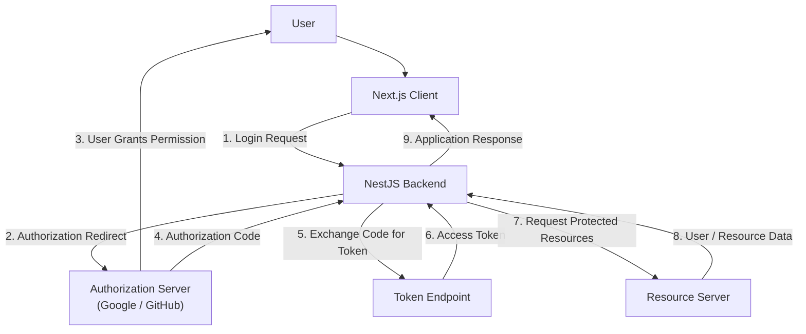

<h1 align="center">OAuth 2.0 Implementation 🔐</h1>

<p align="center">
  A hands-on implementation of OAuth 2.0 and OpenID Connect using Next.js and NestJS, exploring secure authorization and authentication flows.
</p>

<p align="center">
  
  
  
  
  
  
</p>

---

## Overview

This project is designed to understand and implement OAuth 2.0 and OpenID Connect through practical experimentation.

It explores how applications delegate authorization to third-party providers, obtain access tokens, and access protected resources without directly handling users' provider passwords.

The implementation focuses on understanding the underlying HTTP requests, authorization codes, token exchanges, and security mechanisms rather than simply integrating authentication libraries.

## Features and Status

✅ Done &nbsp;·&nbsp; 🚧 In progress &nbsp;·&nbsp; 📋 Planned

| Feature | Status |
| --- | :---: |
| OAuth 2.0 architecture and authorization flow | 🚧 |
| Interactive OAuth playground interface | 📋 |
| Authorization Code Flow | 📋 |
| Google OAuth 2.0 integration | 📋 |
| GitHub OAuth 2.0 integration | 📋 |
| Access token handling | 📋 |
| Protected resource access | 📋 |
| OAuth 2.0 PKCE implementation | 📋 |
| Refresh token handling | 📋 |
| OpenID Connect integration | 📋 |
| Token validation and security mechanisms | 📋 |

## Tech Stack

| Layer | Technology | Purpose |
| --- | --- | --- |
| **Frontend** | Next.js | Framework and routing |
| | React | UI components |
| | TypeScript | Type safety |
| | Tailwind CSS | Styling and theming |
| **Backend** | NestJS (Node.js) | Modular server application |
| | TypeScript | Type safety |
| | REST APIs | Authorization and token endpoints |
| **Authorization** | OAuth 2.0 | Delegated authorization |
| | OpenID Connect | Authentication and identity verification |
| | PKCE | Protection for authorization code exchange |
| | JWT | Token format and validation where applicable |
| **Providers** | Google | Third-party authorization provider |
| | GitHub | Third-party authorization provider |
| **Tools** | Git and GitHub | Version control |
| | Postman | API testing |

## Architecture

The application follows a client-server architecture where the frontend communicates with the NestJS backend, and the backend interacts with external authorization servers.



### Main Components

1. **Resource Owner:** The user who owns the data and grants permission to access it.
2. **Client:** The application requesting access to the user's resources.
3. **Authorization Server:** The server responsible for authenticating the user, obtaining authorization, and issuing tokens.
4. **Resource Server:** The server hosting protected resources that can be accessed using valid access tokens.
5. **Access Token:** A credential used by the client to access protected resources.
6. **Authorization Code:** A temporary code exchanged for an access token.

## OAuth 2.0 Concepts Covered

| Concept | Description |
| --- | --- |
| Authorization Code Flow | Obtaining an authorization code and exchanging it for an access token |
| Client ID | Public identifier assigned to an application |
| Client Secret | Confidential credential used by a server-side client |
| Redirect URI | URL where the authorization server redirects the user |
| Access Token | Credential used to access protected resources |
| Refresh Token | Credential used to obtain new access tokens |
| Scope | Defines the permissions requested by an application |
| State Parameter | Helps protect the authorization flow against CSRF attacks |
| PKCE | Adds protection to the authorization code exchange |
| OpenID Connect | Identity layer built on top of OAuth 2.0 |

## Getting Started

### Prerequisites

- Node.js 20 or later
- npm
- Git
- Google Developer Account (for Google OAuth integration)
- GitHub Account (for GitHub OAuth integration)

### 1. Clone the repository

```bash
git clone <your-repository-url>
cd OAuth2-Implementation
```

### 2. Backend Setup

```bash
cd backend
npm install
```

Create `backend/.env`:

```env
PORT=5000

GOOGLE_CLIENT_ID="your-google-client-id"
GOOGLE_CLIENT_SECRET="your-google-client-secret"
GOOGLE_CALLBACK_URL="http://localhost:5000/auth/google/callback"

GITHUB_CLIENT_ID="your-github-client-id"
GITHUB_CLIENT_SECRET="your-github-client-secret"
GITHUB_CALLBACK_URL="http://localhost:5000/auth/github/callback"

FRONTEND_URL="http://localhost:3000"
```

Start the NestJS development server:

```bash
npm run start:dev
```

### 3. Frontend Setup

Open another terminal:

```bash
cd frontend
npm install
```

Create `frontend/.env.local`:

```env
NEXT_PUBLIC_API_URL="http://localhost:5000"
```

Start the Next.js development server:

```bash
npm run dev
```

Open `http://localhost:3000` in your browser.

**Note:** The environment variables above are illustrative. Configure callback URLs to match your actual backend routes and the redirect URIs registered with each OAuth provider. Never expose client secrets in frontend environment variables or commit `.env` files.

## Project Structure

```text
OAuth2-Implementation/
│
├── frontend/              # Next.js frontend
│   ├── src/
│   │   ├── app/
│   │   ├── components/
│   │   └── lib/
│   └── package.json
│
├── backend/               # NestJS backend
│   ├── src/
│   │   ├── auth/
│   │   ├── oauth/
│   │   ├── google/
│   │   ├── github/
│   │   └── users/
│   └── package.json
│
├── docs/                  # OAuth documentation and flow diagrams
│   ├── oauth-flow.md
│   ├── authorization-code-flow.md
│   └── pkce.md
│
├── .gitignore
└── README.md
```

## Learning Objectives

- Understand the difference between authentication and authorization.
- Understand how OAuth 2.0 delegates access to third-party applications.
- Learn how authorization servers and resource servers communicate.
- Understand the purpose of access tokens and refresh tokens.
- Implement Authorization Code Flow using HTTP requests.
- Understand how PKCE improves authorization security.
- Explore the relationship between OAuth 2.0 and OpenID Connect.
- Understand how OAuth 2.0 is implemented in real-world applications.

## Future Improvements

- Add additional OAuth providers.
- Implement OAuth 2.0 Device Authorization Grant.
- Explore token revocation and introspection.
- Implement secure token storage and rotation.
- Add an interactive visualization of the OAuth authorization flow.
- Compare manual OAuth implementation with Passport.js strategies.

## Author

**Ayush Pant**

## License

This project is developed for educational purposes and practical learning in backend engineering, authentication, authorization, and security.